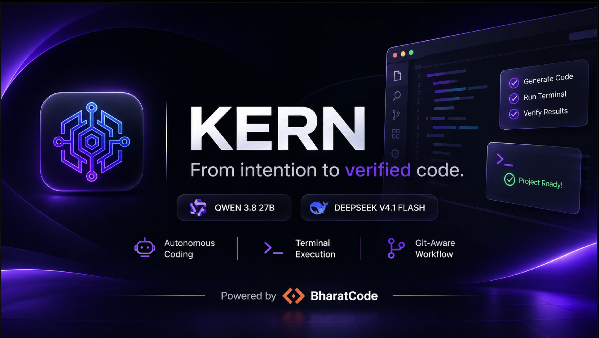
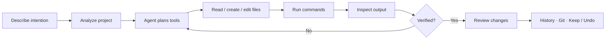
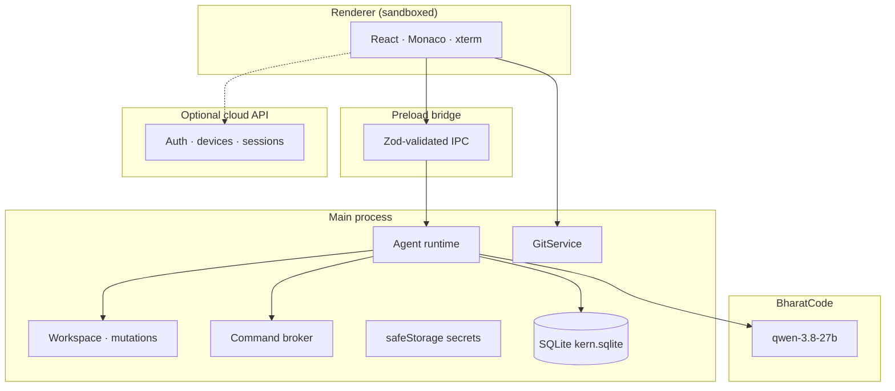

<p align="center">
  
</p>

<h1 align="center">KERN — From intention to verified code.</h1>

<p align="center">
  An independent AI-powered desktop development environment that understands projects,<br />
  writes code, executes development commands, and verifies results.
</p>

<p align="center">
  <strong>Powered by BharatCode models.</strong>
</p>

<p align="center">
  <a href="https://bharatcode.ai/"></a>
  &nbsp;
  
  &nbsp;
  
</p>

---

## From idea to verified project

KERN is a **standalone desktop application** — not a chatbot overlay, not a VS Code extension, and not a disposable prompt window.

It is an independently engineered AI coding environment with its own architecture and workflow:

- An **independent AI coding agent** that plans and executes development work
- A **dedicated desktop IDE surface** with explorer, Monaco editor, terminal, and agent chat
- An **autonomous software development assistant** that reads, writes, runs, and verifies
- A **project-aware conversation system** with persistent chats and mission history

**From an idea to a working, verified project — inside one development environment.**

---

## Powered by BharatCode

KERN is an independent desktop AI coding environment built with **BharatCode model integration**.

The agent runtime calls BharatCode’s model platform to reason about your workspace, propose file operations, and continue from real tool results — not from imagined state.

### Models

| Model | Identifier | Role in KERN |
| --- | --- | --- |
| **Qwen 3.8 27B** | `qwen-3.8-27b` | Default wired coding model for the agent loop |
| **DeepSeek V4.1 Flash** | `deepseek-v4.1-flash` | Featured BharatCode coding model on the product surface |

> KERN is **not** an official BharatCode product and is **not** presented as an exclusive or endorsed partnership. It is an independently engineered environment that integrates with BharatCode’s model APIs.

**Explore BharatCode:** [https://bharatcode.ai/](https://bharatcode.ai/)

<p align="center"><em>Powered by BharatCode</em></p>

---

## Product showcase

### Desktop development environment

<p align="center">
  
</p>

<p align="center"><sub>Explorer with Git status, Monaco editor, integrated terminal, live CPU/RAM/token meters, and a completed agent mission with verification.</sub></p>

### Account access

<table>
  <tr>
    <td width="50%" valign="top">
      
      <p align="center"><sub>Secure log in to your KERN account.</sub></p>
    </td>
    <td width="50%" valign="top">
      
      <p align="center"><sub>Create an account to sync identity across sessions.</sub></p>
    </td>
  </tr>
</table>

<p align="center">
  
</p>

<p align="center"><sub>Password reset flow with emailed recovery codes.</sub></p>

---

## Core capabilities

### Autonomous AI coding

- Understand natural-language development requests
- Inspect existing project structures with recursive listing and search
- Generate multi-file implementations
- Modify existing code through proposed, reviewed operations
- Continue work from **actual** tool results and command output

### Terminal execution

- Run development commands through a controlled main-process broker
- Scaffold projects with the tools already on the machine
- Install dependencies and run tests, lint, typecheck, and builds
- Capture stdout/stderr, timeouts, and failures for the agent to recover

### Project-aware conversations

- Persistent chats tied to the open workspace
- Multiple development missions inside a conversation
- Historical restoration of missions, tools, and file operations
- Context that stays with the project — not a disposable session tab

### Intelligent file management

- Create, edit, rename, and restore files through the agent
- Explicit approval for destructive deletions
- File-change history with diff review
- **Keep** / **Undo All** for eligible open changes

### Git integration

- Workspace-scoped Git status, branch, and change list
- Explorer decorations for modified / added / untracked paths
- Publish / export flows for initializing, committing, remotes, and push
- Credential-safe remote URL validation (no force-push)

### Security and control

- Sandboxed renderer — no Node/fs/shell access in the UI
- Zod-validated IPC between renderer and main
- Workspace path jail for filesystem operations
- Command runner with scrubbed environment and policy checks
- API keys encrypted with Electron `safeStorage` in the main process
- Destructive deletes require explicit user approval

---

## How KERN works



1. **Describe your intention** in the agent composer  
2. **KERN analyzes** the open workspace  
3. The agent builds an **execution plan** as tool calls  
4. KERN **reads, creates, and modifies** files (writes are proposed and applied under policy)  
5. KERN **executes** development commands in a controlled runner  
6. KERN **inspects outputs** and continues until verification or a clear stop  
7. **You review** diffs, history, and Git state  

**Approval boundary:** destructive deletions always require explicit user approval. Everyday create/edit/rename follow the mission policy; the UI surfaces proposals, failures, and verification clearly.

---

## Architecture



| Layer | Technology |
| --- | --- |
| Desktop shell | Electron 45 |
| UI | React 19 · TypeScript · Vite |
| Editor | Monaco Editor |
| Terminal | node-pty · xterm.js |
| Agent | Node/TypeScript loop in main |
| Persistence | SQLite (`kern.sqlite`) |
| Models | BharatCode API (`qwen-3.8-27b`) |
| Validation | Zod IPC contracts |
| Cloud (optional) | Self-hosted Express API + PostgreSQL |

**Security boundary:** the renderer never receives filesystem or shell privileges. All privileged work crosses the preload bridge into the main process, where path jails, command policy, Git execution, and encrypted secrets live.

---

## Installation and development

### Prerequisites

- **Node.js** `>= 22.12`
- **pnpm** `12.x` (see `packageManager` in `package.json`)
- macOS, Windows, or Linux suitable for Electron
- A **BharatCode API key** for model requests

### Setup

```bash
pnpm install
```

Store your BharatCode API key in **Settings** inside the app (encrypted via Electron `safeStorage`).  
Do not commit keys. Environment placeholders if you script around the desktop app:

```bash
# Example only — never commit real values
# BHARATCODE_API_KEY=your_bharatcode_api_key_here
# KERN_API_URL=https://your-kern-api.example
```

### Run

```bash
pnpm dev
```

### Build / quality

```bash
pnpm build
pnpm typecheck
pnpm lint
pnpm test
```

### Optional cloud API (self-hosted)

```bash
pnpm server:dev
pnpm server:test
pnpm server:build
```

See `server/README.md` and `docs/self-hosted-deployment.md` for database, SMTP, and deployment configuration.

You need valid access to BharatCode for the agent to run missions. Without a configured key, KERN remains a local IDE shell with auth and workspace tools available.

---

## Roadmap

Honest, unfinished work — not a marketing calendar:

- **Cloud sync** — project/chat/mission push-pull and conflict resolution (Phase 2G)
- **Broader BharatCode model selection** in Settings beyond the default `qwen-3.8-27b` wiring
- **Git hosting OAuth** — optional first-party auth helpers (CLI/`gh` flows exist; in-app OAuth deferred)
- **Agent Git write tools** — commit/push remain user-driven; agent keeps read-oriented Git visibility

Implemented capabilities above are **not** listed as future work.

---

## Contributing

KERN is an **independent** engineering project. Contributions that improve reliability, security, and agent quality are welcome.

1. Fork and branch from `main`
2. Keep changes focused; prefer tests for agent, IPC, and security surfaces
3. Run `pnpm typecheck`, `pnpm lint`, and `pnpm test` before opening a PR

### Attribution

- **BharatCode** — model platform powering KERN’s AI coding agent · [bharatcode.ai](https://bharatcode.ai/)
- Open-source dependencies are declared in `package.json` / `server/package.json` (Electron, React, Monaco, Zod, Drizzle, and others)

### License

No root `LICENSE` file is published in this repository yet. Treat the project as **source-available for collaboration** until a license is added by the maintainers. Do not assume redistribution rights beyond what the owners grant.

---

<p align="center">
  <strong>KERN</strong><br />
  From intention to verified code.<br />
  <em>Powered by BharatCode</em>
</p>
